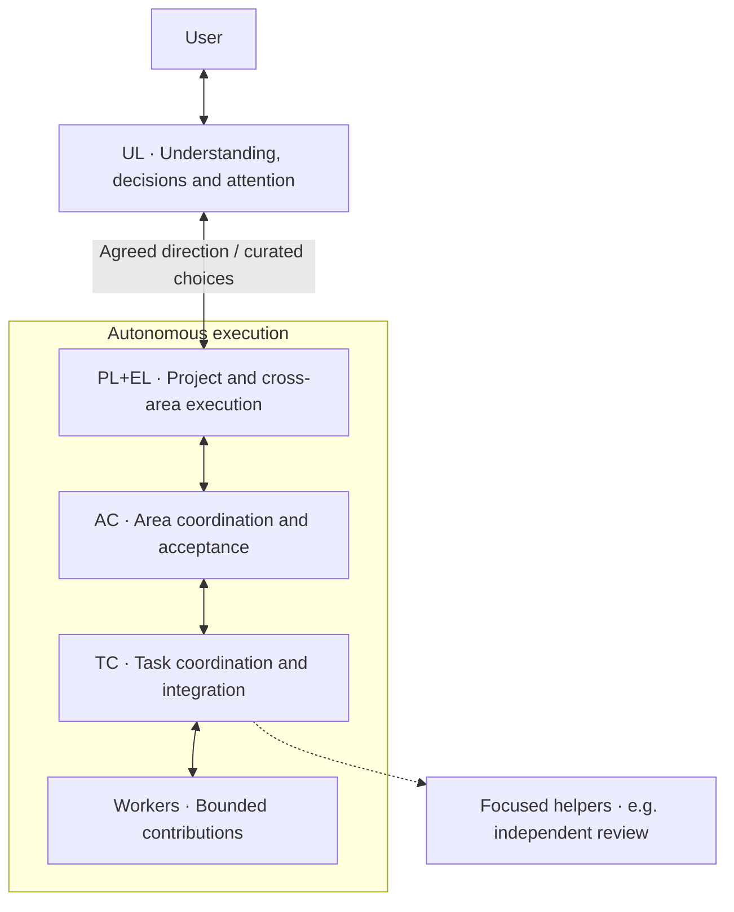

# Agent Workflow

An experimental skill collection for human-directed agent teams. Persistent
roles provide continuity; the agents occupying them can change. Coordinators
exercise judgment within explicit scope, permissions and resource allowances.

## Installable skills

| Skill | Use |
| --- | --- |
| agent-workflow | One guided setup/resume walkthrough, including workspace preparation and role handoff. |
| agent-hierarchy | Establish, operate, split or resume UL, executive PL/EL, AC, TC and workers, with focused helpers. |
| agent-workspace | Adapt an existing project or prepare a practice workspace for the hierarchy. |
| agent-task | Define, claim, report, review and integrate a bounded deliverable. |

The hierarchy and project workflow can be used independently. An existing
repository supplies its own record locations and conventions through a small
project agreement. No orchestration service or MCP server is required.

## Install

Ask Codex's skill installer:

> Install agent-workflow, agent-hierarchy, agent-workspace and agent-task from
> lleisner/agent-workflow, using their directories under skills/.

Install a tested tag or commit on each machine when reproducibility matters.
Each skill includes its own references and helpers; do not install only SKILL.md.
For local development, Codex also supports linking skill directories into its
user skill discovery directory. Avoid installing duplicate copies with the same
skill name.

The scripts require Python 3.9+, Git, and the GitHub CLI for GitHub operations.
The local allowance writer currently supports macOS/Linux file locking.
Codex session operations require a compatible, signed-in Codex CLI. Local skill
installation does not transfer running sessions, credentials or uncommitted code.
Host-specific behavior must be checked on each supported platform.

## Start

In a fresh session in the intended project, invoke **$agent-workflow** once.
The setup facilitator inspects the repository, guides only unresolved choices,
prepares the agreed workspace and tracker, and starts or reconnects the authorized
initial roles. It writes and delivers their focused handoffs and shows you which
contact is ready for your next project conversation. You do not compose launch
prompts or invoke the component skills in sequence.

The setup facilitator is temporary; UL and executive leadership receive settled
context instead of inheriting the onboarding conversation. Repeat the same invocation to resume an
interrupted setup without duplicating roles or renewing allowances.

Install all four directories for this complete walkthrough. The three component
skills can still be installed and used independently for existing role operations,
workspace-only setup or solo task workflows. Existing project conventions remain
configurable. The initial model is a conversation-first User Liaison (UL) plus
an executive PL+EL occupant. AC+TC can also share an occupant. Executive PL becomes
separate only for an authorized expansion to multiple ELs; existing live roles
are not renamed or reconfigured by updating this repository.

Published plans and decisions have a canonical branch. Live task state and
concise reports use GitHub issues/comments in the supplied starter workflow.
Implementation branches contain code, evidence and working drafts.

## Hierarchy

One representative branch is shown. Assignments and refinements go down;
curated results, implications and decision requests go up. Every supervisor
coordinates work throughout execution. Helpers can support any role without
becoming another rank. UL and the user can contact other roles directly when
useful, keeping affected owners informed.

PL+EL normally shares one occupant. A separate executive PL becomes useful only
for an authorized expansion to multiple ELs. AC+TC can likewise share an occupant
when one task covers the area's work. See [the operating model](docs/DESIGN.md)
for transfer, review and approval boundaries.

## Role profiles

The hierarchy package now authors role instructions once and assembles complete
Codex profiles, including PL+EL and AC+TC combinations. See the
[profile map](skills/agent-hierarchy/references/roles.md) and
[assembly/startup guide](skills/agent-hierarchy/references/profiles.md).

~~~sh
python3 skills/agent-hierarchy/scripts/profiles.py --write
python3 skills/agent-hierarchy/scripts/profiles.py --check
~~~

These commands only regenerate/check bundled assets. Skill installation does not
install them as active Codex profiles. Adoption must preserve project settings,
existing occupants and local customizations. The isolated trial verified applying
assembled instructions/settings to independent sessions and UL-to-AC messaging.
The tested native-child route rejected direct UL input and exposed no custom-profile
selector. Writable human attachment remains unverified; see [runtime evidence](docs/VALIDATION.md).

## Maturity

This is a pilot implementation, not an assurance of unattended execution.
See [validation](docs/VALIDATION.md) for tested behavior and open runtime checks.
The skills express authority and budget rules; helpers do not enforce every
action the agent or its tools can take.

When enabled, numerical allowances bound autonomous work including coordination
and helper usage. Explicit limits always apply. Setup and ordinary leadership
conversations have no mandatory numeric cap; a project-wide time-window
allocation is optional. Estimated-credit accounting is
not an exact subscription percentage.
Dynamic subscription optimization, extensive specialist libraries, automatic
skill improvement and a separate starter-template repository are later work.

The pilot uses bounded real project work; synthetic fixtures remain useful for
helper tests. Keep project-specific records separate from this reusable source.
Do not publish project transcripts, private mappings, credentials or local ledgers
here.

## Contribute and verify

Run:

~~~sh
python3 -m unittest discover -s tests -v
python3 scripts/validate.py
~~~

Run the tests on Python 3.11+ as well to include TOML roundtrip validation; the
assembler and existing helpers remain compatible with Python 3.9+.

Use [the design](docs/DESIGN.md) for accepted behavior. Keep reusable instructions
separate from project-specific settings, and prefer bounded improvements based on
observed failures. License selection is pending; no open-source license is
asserted by this initial experimental publication.
